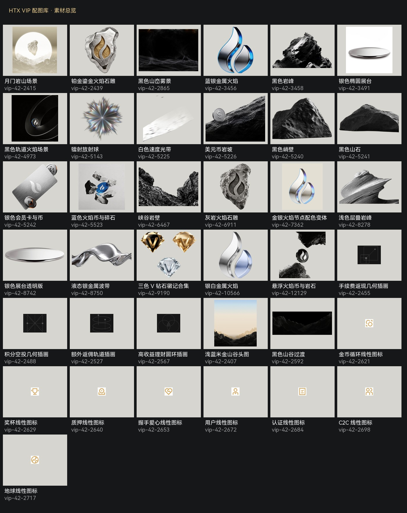

# HTX VIP 配图库

44 项已整理素材：主体 9、背景 11、权益插画 4、权益图标 8、装饰 5、备选 7。保留原始尺寸与透明度，PNG 与可编辑 SVG 按原素材提供。

- [可视化目录](index.html)
- [下载与语义索引](manifest.json)：名称、用途、分类、状态、路径、尺寸、SHA-256 与 Figma 来源。
- [原始归档索引](catalog.json)

优先使用「定稿复用」，「可见备选」按主题选择，「隐藏备选」仅在明确指定时使用。不要将预览缩略图用于成品；使用 primary 指向的素材。历史素材内的文案不代表新活动权益。

来源：[Figma VIP 配图库](https://www.figma.com/design/wqcnMW66GZliX2G40KyuSH/SVIP?node-id=651-2379)。
