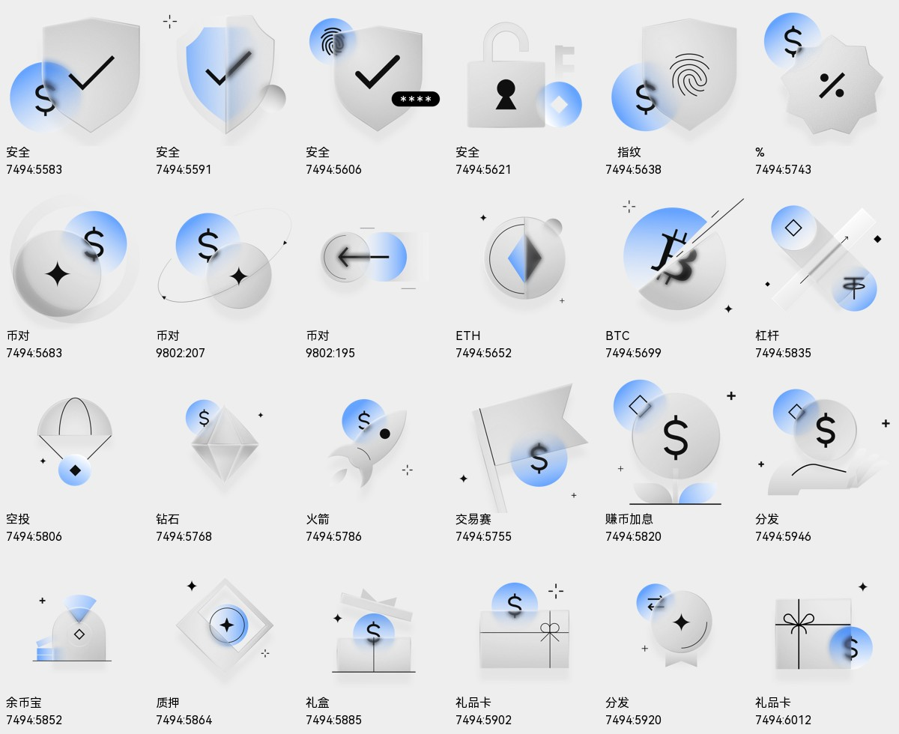
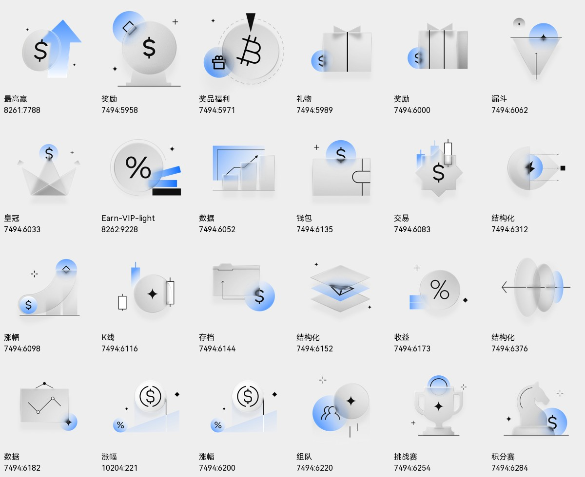
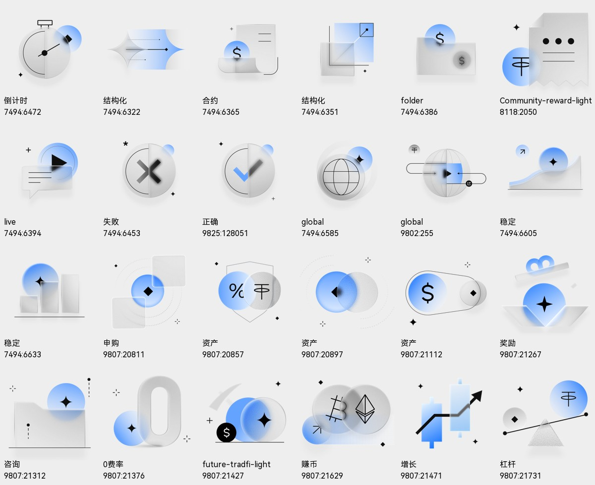
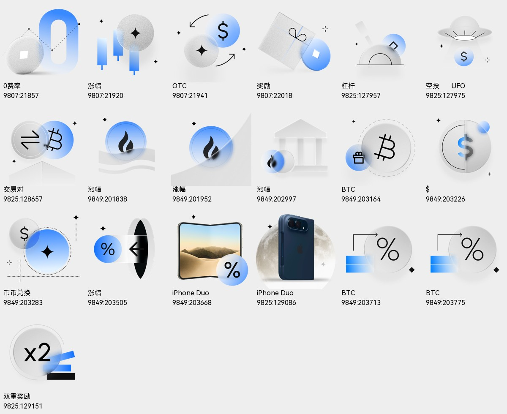

# HTX L3 标准版 · 白天配图库

91 张透明 PNG，原始 256×256 图层原生 4× 导出为 1024×1024。仅移除展示画板底色，原始配图内容与颜色保持不变。

来源：中台资源库4.0，页面 `7174:7829` 的 L3标准版区域。明暗主题通过原画板填充和 light/dark 标记核对。原稿中的少数名称与图意不符，`name/sourceName` 保留原名，`label/description/keywords` 按图意标注，自动选图以后三项为准。

- [机器索引](manifest.json)
- [自动调用 skill](../../../skills/htx-brand/SKILL.md)

## 素材

| ID | 图意 | PNG | 来源 |
|---|---|---|---|
| l3-light-7494-5583 | 美元盾牌与勾选 | [1024px](l3-light-7494-5583.png) | [Figma](https://www.figma.com/design/SzTzif4U7HRd2CorAGocTk/?node-id=7494-5583) |
| l3-light-7494-5591 | 蓝白盾牌与勾选 | [1024px](l3-light-7494-5591.png) | [Figma](https://www.figma.com/design/SzTzif4U7HRd2CorAGocTk/?node-id=7494-5591) |
| l3-light-7494-5606 | 指纹密码盾牌 | [1024px](l3-light-7494-5606.png) | [Figma](https://www.figma.com/design/SzTzif4U7HRd2CorAGocTk/?node-id=7494-5606) |
| l3-light-7494-5621 | 锁与钥匙 | [1024px](l3-light-7494-5621.png) | [Figma](https://www.figma.com/design/SzTzif4U7HRd2CorAGocTk/?node-id=7494-5621) |
| l3-light-7494-5638 | 指纹盾牌与美元 | [1024px](l3-light-7494-5638.png) | [Figma](https://www.figma.com/design/SzTzif4U7HRd2CorAGocTk/?node-id=7494-5638) |
| l3-light-7494-5743 | 百分比徽章与美元 | [1024px](l3-light-7494-5743.png) | [Figma](https://www.figma.com/design/SzTzif4U7HRd2CorAGocTk/?node-id=7494-5743) |
| l3-light-7494-5683 | 美元与圆形币对 | [1024px](l3-light-7494-5683.png) | [Figma](https://www.figma.com/design/SzTzif4U7HRd2CorAGocTk/?node-id=7494-5683) |
| l3-light-9802-207 | 美元与轨道圆形币对 | [1024px](l3-light-9802-207.png) | [Figma](https://www.figma.com/design/SzTzif4U7HRd2CorAGocTk/?node-id=9802-207) |
| l3-light-9802-195 | 双币与左箭头 | [1024px](l3-light-9802-195.png) | [Figma](https://www.figma.com/design/SzTzif4U7HRd2CorAGocTk/?node-id=9802-195) |
| l3-light-7494-5652 | 以太坊标志币 | [1024px](l3-light-7494-5652.png) | [Figma](https://www.figma.com/design/SzTzif4U7HRd2CorAGocTk/?node-id=7494-5652) |
| l3-light-7494-5699 | 比特币标志与斜线 | [1024px](l3-light-7494-5699.png) | [Figma](https://www.figma.com/design/SzTzif4U7HRd2CorAGocTk/?node-id=7494-5699) |
| l3-light-7494-5835 | 杠杆百分比与代币 | [1024px](l3-light-7494-5835.png) | [Figma](https://www.figma.com/design/SzTzif4U7HRd2CorAGocTk/?node-id=7494-5835) |
| l3-light-7494-5806 | 降落伞与代币 | [1024px](l3-light-7494-5806.png) | [Figma](https://www.figma.com/design/SzTzif4U7HRd2CorAGocTk/?node-id=7494-5806) |
| l3-light-7494-5768 | 钻石与美元 | [1024px](l3-light-7494-5768.png) | [Figma](https://www.figma.com/design/SzTzif4U7HRd2CorAGocTk/?node-id=7494-5768) |
| l3-light-7494-5786 | 火箭与美元 | [1024px](l3-light-7494-5786.png) | [Figma](https://www.figma.com/design/SzTzif4U7HRd2CorAGocTk/?node-id=7494-5786) |
| l3-light-7494-5755 | 旗帜与美元 | [1024px](l3-light-7494-5755.png) | [Figma](https://www.figma.com/design/SzTzif4U7HRd2CorAGocTk/?node-id=7494-5755) |
| l3-light-7494-5820 | 萌芽美元币 | [1024px](l3-light-7494-5820.png) | [Figma](https://www.figma.com/design/SzTzif4U7HRd2CorAGocTk/?node-id=7494-5820) |
| l3-light-7494-5946 | 手托美元币 | [1024px](l3-light-7494-5946.png) | [Figma](https://www.figma.com/design/SzTzif4U7HRd2CorAGocTk/?node-id=7494-5946) |
| l3-light-7494-5852 | 储蓄袋与柱形图 | [1024px](l3-light-7494-5852.png) | [Figma](https://www.figma.com/design/SzTzif4U7HRd2CorAGocTk/?node-id=7494-5852) |
| l3-light-7494-5864 | 菱形质押币 | [1024px](l3-light-7494-5864.png) | [Figma](https://www.figma.com/design/SzTzif4U7HRd2CorAGocTk/?node-id=7494-5864) |
| l3-light-7494-5885 | 打开的礼盒与美元 | [1024px](l3-light-7494-5885.png) | [Figma](https://www.figma.com/design/SzTzif4U7HRd2CorAGocTk/?node-id=7494-5885) |
| l3-light-7494-5902 | 礼品卡与美元币 | [1024px](l3-light-7494-5902.png) | [Figma](https://www.figma.com/design/SzTzif4U7HRd2CorAGocTk/?node-id=7494-5902) |
| l3-light-7494-5920 | 奖章与双向箭头 | [1024px](l3-light-7494-5920.png) | [Figma](https://www.figma.com/design/SzTzif4U7HRd2CorAGocTk/?node-id=7494-5920) |
| l3-light-7494-6012 | 蝴蝶结礼品卡 | [1024px](l3-light-7494-6012.png) | [Figma](https://www.figma.com/design/SzTzif4U7HRd2CorAGocTk/?node-id=7494-6012) |
| l3-light-8261-7788 | 美元币与向上箭头 | [1024px](l3-light-8261-7788.png) | [Figma](https://www.figma.com/design/SzTzif4U7HRd2CorAGocTk/?node-id=8261-7788) |
| l3-light-7494-5958 | 美元奖杯底座 | [1024px](l3-light-7494-5958.png) | [Figma](https://www.figma.com/design/SzTzif4U7HRd2CorAGocTk/?node-id=7494-5958) |
| l3-light-7494-5971 | 比特币礼物圆环 | [1024px](l3-light-7494-5971.png) | [Figma](https://www.figma.com/design/SzTzif4U7HRd2CorAGocTk/?node-id=7494-5971) |
| l3-light-7494-5989 | 方形礼物盒 | [1024px](l3-light-7494-5989.png) | [Figma](https://www.figma.com/design/SzTzif4U7HRd2CorAGocTk/?node-id=7494-5989) |
| l3-light-7494-6000 | 竖形礼盒 | [1024px](l3-light-7494-6000.png) | [Figma](https://www.figma.com/design/SzTzif4U7HRd2CorAGocTk/?node-id=7494-6000) |
| l3-light-7494-6062 | 漏斗与双圆球 | [1024px](l3-light-7494-6062.png) | [Figma](https://www.figma.com/design/SzTzif4U7HRd2CorAGocTk/?node-id=7494-6062) |
| l3-light-7494-6033 | 皇冠与美元 | [1024px](l3-light-7494-6033.png) | [Figma](https://www.figma.com/design/SzTzif4U7HRd2CorAGocTk/?node-id=7494-6033) |
| l3-light-8262-9228 | 百分比与黑蓝条形 | [1024px](l3-light-8262-9228.png) | [Figma](https://www.figma.com/design/SzTzif4U7HRd2CorAGocTk/?node-id=8262-9228) |
| l3-light-7494-6052 | 递增柱形与折线 | [1024px](l3-light-7494-6052.png) | [Figma](https://www.figma.com/design/SzTzif4U7HRd2CorAGocTk/?node-id=7494-6052) |
| l3-light-7494-6135 | 钱包与美元币 | [1024px](l3-light-7494-6135.png) | [Figma](https://www.figma.com/design/SzTzif4U7HRd2CorAGocTk/?node-id=7494-6135) |
| l3-light-7494-6083 | K线美元徽章 | [1024px](l3-light-7494-6083.png) | [Figma](https://www.figma.com/design/SzTzif4U7HRd2CorAGocTk/?node-id=7494-6083) |
| l3-light-7494-6312 | 闪电与分支箭头 | [1024px](l3-light-7494-6312.png) | [Figma](https://www.figma.com/design/SzTzif4U7HRd2CorAGocTk/?node-id=7494-6312) |
| l3-light-7494-6098 | 向上曲线与美元 | [1024px](l3-light-7494-6098.png) | [Figma](https://www.figma.com/design/SzTzif4U7HRd2CorAGocTk/?node-id=7494-6098) |
| l3-light-7494-6116 | K线与星形币 | [1024px](l3-light-7494-6116.png) | [Figma](https://www.figma.com/design/SzTzif4U7HRd2CorAGocTk/?node-id=7494-6116) |
| l3-light-7494-6144 | 文件夹与上涨线 | [1024px](l3-light-7494-6144.png) | [Figma](https://www.figma.com/design/SzTzif4U7HRd2CorAGocTk/?node-id=7494-6144) |
| l3-light-7494-6152 | 多层菱形结构 | [1024px](l3-light-7494-6152.png) | [Figma](https://www.figma.com/design/SzTzif4U7HRd2CorAGocTk/?node-id=7494-6152) |
| l3-light-7494-6173 | 百分比与蓝色柱形 | [1024px](l3-light-7494-6173.png) | [Figma](https://www.figma.com/design/SzTzif4U7HRd2CorAGocTk/?node-id=7494-6173) |
| l3-light-7494-6376 | 多层圆盘与箭头 | [1024px](l3-light-7494-6376.png) | [Figma](https://www.figma.com/design/SzTzif4U7HRd2CorAGocTk/?node-id=7494-6376) |
| l3-light-7494-6182 | 折线数据图 | [1024px](l3-light-7494-6182.png) | [Figma](https://www.figma.com/design/SzTzif4U7HRd2CorAGocTk/?node-id=7494-6182) |
| l3-light-10204-221 | 美元币与利率阶梯 | [1024px](l3-light-10204-221.png) | [Figma](https://www.figma.com/design/SzTzif4U7HRd2CorAGocTk/?node-id=10204-221) |
| l3-light-7494-6200 | 美元币与利率阶梯 | [1024px](l3-light-7494-6200.png) | [Figma](https://www.figma.com/design/SzTzif4U7HRd2CorAGocTk/?node-id=7494-6200) |
| l3-light-7494-6220 | 双人轮廓与币 | [1024px](l3-light-7494-6220.png) | [Figma](https://www.figma.com/design/SzTzif4U7HRd2CorAGocTk/?node-id=7494-6220) |
| l3-light-7494-6254 | 奖杯与星形 | [1024px](l3-light-7494-6254.png) | [Figma](https://www.figma.com/design/SzTzif4U7HRd2CorAGocTk/?node-id=7494-6254) |
| l3-light-7494-6284 | 棋马与美元 | [1024px](l3-light-7494-6284.png) | [Figma](https://www.figma.com/design/SzTzif4U7HRd2CorAGocTk/?node-id=7494-6284) |
| l3-light-7494-6472 | 秒表 | [1024px](l3-light-7494-6472.png) | [Figma](https://www.figma.com/design/SzTzif4U7HRd2CorAGocTk/?node-id=7494-6472) |
| l3-light-7494-6322 | 蓝白双向箭头 | [1024px](l3-light-7494-6322.png) | [Figma](https://www.figma.com/design/SzTzif4U7HRd2CorAGocTk/?node-id=7494-6322) |
| l3-light-7494-6365 | 合约票据与美元 | [1024px](l3-light-7494-6365.png) | [Figma](https://www.figma.com/design/SzTzif4U7HRd2CorAGocTk/?node-id=7494-6365) |
| l3-light-7494-6351 | 叠层方块与上涨箭头 | [1024px](l3-light-7494-6351.png) | [Figma](https://www.figma.com/design/SzTzif4U7HRd2CorAGocTk/?node-id=7494-6351) |
| l3-light-7494-6386 | 文件夹与美元 | [1024px](l3-light-7494-6386.png) | [Figma](https://www.figma.com/design/SzTzif4U7HRd2CorAGocTk/?node-id=7494-6386) |
| l3-light-8118-2050 | 收据与USDT | [1024px](l3-light-8118-2050.png) | [Figma](https://www.figma.com/design/SzTzif4U7HRd2CorAGocTk/?node-id=8118-2050) |
| l3-light-7494-6394 | 播放按钮与聊天框 | [1024px](l3-light-7494-6394.png) | [Figma](https://www.figma.com/design/SzTzif4U7HRd2CorAGocTk/?node-id=7494-6394) |
| l3-light-7494-6453 | 圆形叉号 | [1024px](l3-light-7494-6453.png) | [Figma](https://www.figma.com/design/SzTzif4U7HRd2CorAGocTk/?node-id=7494-6453) |
| l3-light-9825-128051 | 圆形勾选 | [1024px](l3-light-9825-128051.png) | [Figma](https://www.figma.com/design/SzTzif4U7HRd2CorAGocTk/?node-id=9825-128051) |
| l3-light-7494-6585 | 地球与星形币 | [1024px](l3-light-7494-6585.png) | [Figma](https://www.figma.com/design/SzTzif4U7HRd2CorAGocTk/?node-id=7494-6585) |
| l3-light-9802-255 | 地球与资产转移路径 | [1024px](l3-light-9802-255.png) | [Figma](https://www.figma.com/design/SzTzif4U7HRd2CorAGocTk/?node-id=9802-255) |
| l3-light-7494-6605 | 平滑上升曲线 | [1024px](l3-light-7494-6605.png) | [Figma](https://www.figma.com/design/SzTzif4U7HRd2CorAGocTk/?node-id=7494-6605) |
| l3-light-7494-6633 | 递增柱形与蓝币 | [1024px](l3-light-7494-6633.png) | [Figma](https://www.figma.com/design/SzTzif4U7HRd2CorAGocTk/?node-id=7494-6633) |
| l3-light-9807-20811 | 双卡片与币 | [1024px](l3-light-9807-20811.png) | [Figma](https://www.figma.com/design/SzTzif4U7HRd2CorAGocTk/?node-id=9807-20811) |
| l3-light-9807-20857 | 百分比USDT盾牌 | [1024px](l3-light-9807-20857.png) | [Figma](https://www.figma.com/design/SzTzif4U7HRd2CorAGocTk/?node-id=9807-20857) |
| l3-light-9807-20897 | 双圆币与轨迹 | [1024px](l3-light-9807-20897.png) | [Figma](https://www.figma.com/design/SzTzif4U7HRd2CorAGocTk/?node-id=9807-20897) |
| l3-light-9807-21112 | 美元币横向胶囊 | [1024px](l3-light-9807-21112.png) | [Figma](https://www.figma.com/design/SzTzif4U7HRd2CorAGocTk/?node-id=9807-21112) |
| l3-light-9807-21267 | 打开礼盒与星形 | [1024px](l3-light-9807-21267.png) | [Figma](https://www.figma.com/design/SzTzif4U7HRd2CorAGocTk/?node-id=9807-21267) |
| l3-light-9807-21312 | 文件卡片与星形 | [1024px](l3-light-9807-21312.png) | [Figma](https://www.figma.com/design/SzTzif4U7HRd2CorAGocTk/?node-id=9807-21312) |
| l3-light-9807-21376 | 立体数字零 | [1024px](l3-light-9807-21376.png) | [Figma](https://www.figma.com/design/SzTzif4U7HRd2CorAGocTk/?node-id=9807-21376) |
| l3-light-9807-21427 | 圆币与黑色美元 | [1024px](l3-light-9807-21427.png) | [Figma](https://www.figma.com/design/SzTzif4U7HRd2CorAGocTk/?node-id=9807-21427) |
| l3-light-9807-21629 | 比特币以太坊双币 | [1024px](l3-light-9807-21629.png) | [Figma](https://www.figma.com/design/SzTzif4U7HRd2CorAGocTk/?node-id=9807-21629) |
| l3-light-9807-21471 | 蓝色K线与上涨箭头 | [1024px](l3-light-9807-21471.png) | [Figma](https://www.figma.com/design/SzTzif4U7HRd2CorAGocTk/?node-id=9807-21471) |
| l3-light-9807-21731 | 跷跷板与USDT | [1024px](l3-light-9807-21731.png) | [Figma](https://www.figma.com/design/SzTzif4U7HRd2CorAGocTk/?node-id=9807-21731) |
| l3-light-9807-21857 | 蓝色数字零与圆币 | [1024px](l3-light-9807-21857.png) | [Figma](https://www.figma.com/design/SzTzif4U7HRd2CorAGocTk/?node-id=9807-21857) |
| l3-light-9807-21920 | 蓝色K线与星形 | [1024px](l3-light-9807-21920.png) | [Figma](https://www.figma.com/design/SzTzif4U7HRd2CorAGocTk/?node-id=9807-21920) |
| l3-light-9807-21941 | 美元与循环双向箭头 | [1024px](l3-light-9807-21941.png) | [Figma](https://www.figma.com/design/SzTzif4U7HRd2CorAGocTk/?node-id=9807-21941) |
| l3-light-9807-22018 | 倾斜礼盒与蓝币 | [1024px](l3-light-9807-22018.png) | [Figma](https://www.figma.com/design/SzTzif4U7HRd2CorAGocTk/?node-id=9807-22018) |
| l3-light-9825-127957 | 半圆杠杆仪表 | [1024px](l3-light-9825-127957.png) | [Figma](https://www.figma.com/design/SzTzif4U7HRd2CorAGocTk/?node-id=9825-127957) |
| l3-light-9825-127975 | 飞碟与美元币 | [1024px](l3-light-9825-127975.png) | [Figma](https://www.figma.com/design/SzTzif4U7HRd2CorAGocTk/?node-id=9825-127975) |
| l3-light-9825-128657 | 比特币与双向箭头 | [1024px](l3-light-9825-128657.png) | [Figma](https://www.figma.com/design/SzTzif4U7HRd2CorAGocTk/?node-id=9825-128657) |
| l3-light-9849-201838 | HTX火焰币与波浪底座 | [1024px](l3-light-9849-201838.png) | [Figma](https://www.figma.com/design/SzTzif4U7HRd2CorAGocTk/?node-id=9849-201838) |
| l3-light-9849-201952 | HTX火焰币与上升坡道 | [1024px](l3-light-9849-201952.png) | [Figma](https://www.figma.com/design/SzTzif4U7HRd2CorAGocTk/?node-id=9849-201952) |
| l3-light-9849-202997 | 银行建筑与HTX币 | [1024px](l3-light-9849-202997.png) | [Figma](https://www.figma.com/design/SzTzif4U7HRd2CorAGocTk/?node-id=9849-202997) |
| l3-light-9849-203164 | 比特币与礼物图标 | [1024px](l3-light-9849-203164.png) | [Figma](https://www.figma.com/design/SzTzif4U7HRd2CorAGocTk/?node-id=9849-203164) |
| l3-light-9849-203226 | 美元半圆币 | [1024px](l3-light-9849-203226.png) | [Figma](https://www.figma.com/design/SzTzif4U7HRd2CorAGocTk/?node-id=9849-203226) |
| l3-light-9849-203283 | 蓝白币与美元 | [1024px](l3-light-9849-203283.png) | [Figma](https://www.figma.com/design/SzTzif4U7HRd2CorAGocTk/?node-id=9849-203283) |
| l3-light-9849-203505 | 百分比与左向箭头 | [1024px](l3-light-9849-203505.png) | [Figma](https://www.figma.com/design/SzTzif4U7HRd2CorAGocTk/?node-id=9849-203505) |
| l3-light-9849-203668 | 折叠屏设备与百分比 | [1024px](l3-light-9849-203668.png) | [Figma](https://www.figma.com/design/SzTzif4U7HRd2CorAGocTk/?node-id=9849-203668) |
| l3-light-9825-129086 | 手机与月球背景 | [1024px](l3-light-9825-129086.png) | [Figma](https://www.figma.com/design/SzTzif4U7HRd2CorAGocTk/?node-id=9825-129086) |
| l3-light-9849-203713 | 百分比与蓝色柱形 | [1024px](l3-light-9849-203713.png) | [Figma](https://www.figma.com/design/SzTzif4U7HRd2CorAGocTk/?node-id=9849-203713) |
| l3-light-9849-203775 | 百分比与灰色柱形 | [1024px](l3-light-9849-203775.png) | [Figma](https://www.figma.com/design/SzTzif4U7HRd2CorAGocTk/?node-id=9849-203775) |
| l3-light-9825-129151 | 双倍符号与黑蓝条形 | [1024px](l3-light-9825-129151.png) | [Figma](https://www.figma.com/design/SzTzif4U7HRd2CorAGocTk/?node-id=9825-129151) |
