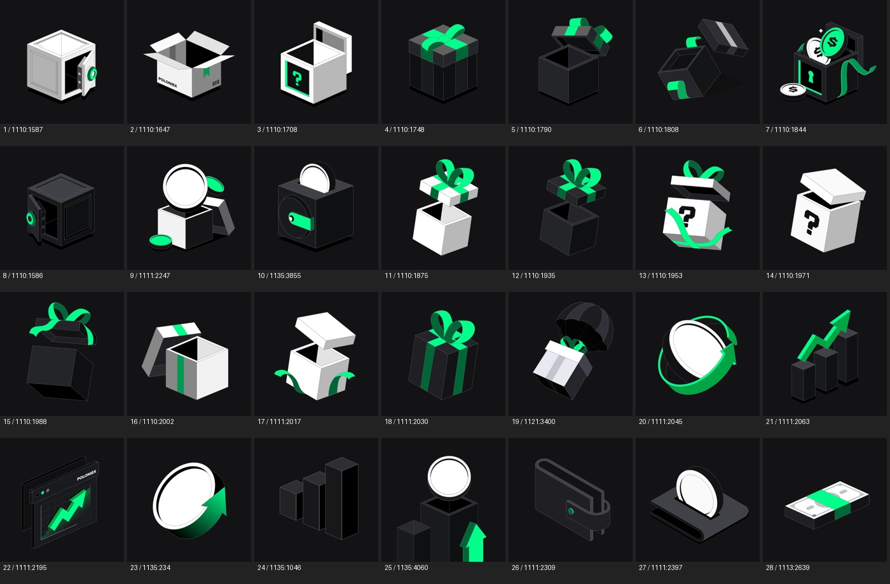
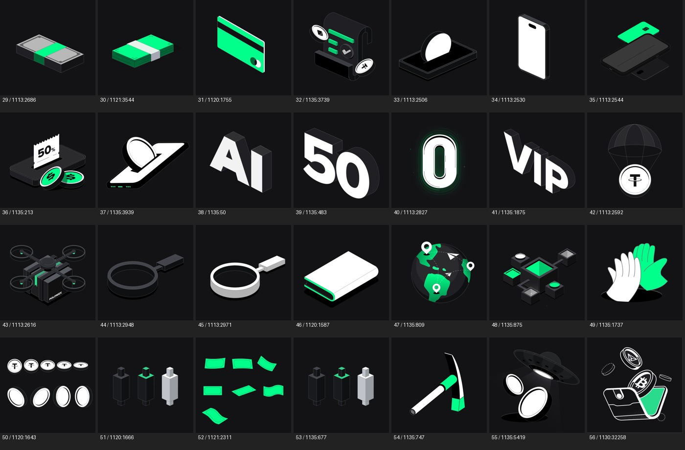

# Poloniex 深色插画库

56 张来自视觉规范「元素组件Elements」页的深色背景 PNG。保留原始 #131316 背景，**不是透明 PNG**。按用户要求排除白底画板和 Banner。深底上的白色主体仍属于深色版本。

[语义索引](manifest.json)包含名称、关键词、原始 Figma 节点、尺寸及 SHA-256。总览编号与 catalogNumber 对应。51/53 等视觉近似项保留为源文件中的不同节点，不根据外观擅自合并。

来源：https://www.figma.com/design/8hZ3aREojjoyd9eRBHddFp/?node-id=99-108

只作为授权 Poloniex 品牌素材使用。素材中已有的 50%、50 等字样不能作为新活动事实；使用前核对业务内容。字体或文字为图形组成的历史插画不作为新文案字体规范。
